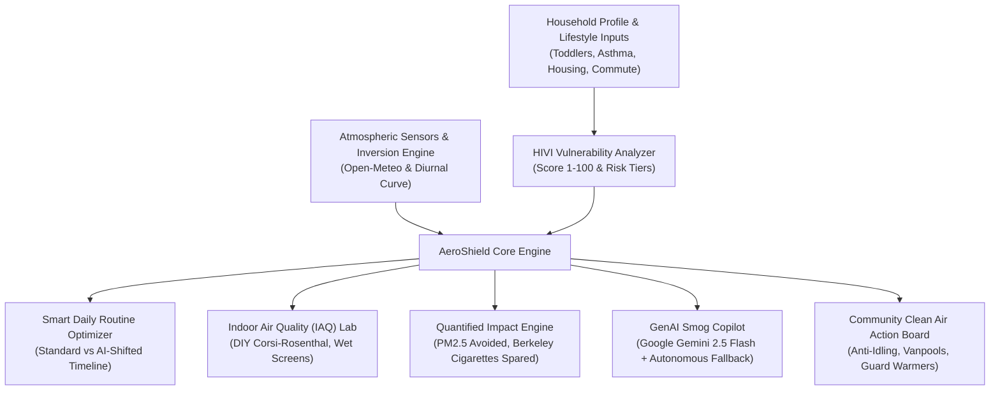

# 🛡️ AeroShield AI: Winter Smog & Urban Air Intelligence Assistant

> **A GenAI-powered adaptive copilot helping families and communities navigate severe winter smog, diurnal thermal inversions, and hazardous urban air pollution.**

[-emerald)](#testing--validation)
[](#technology-stack)
[](#genai-integration--reasoning-engine)
[](#accessibility--inclusive-design)
[](LICENSE)

---

## 📌 Executive Summary & Chosen Vertical

### 1. Chosen Vertical
**"Urban Families & Vulnerable Community Households (Elderly, Children under 5, Asthmatics, Expectant Mothers) Navigating Severe Winter Smog & Seasonal Thermal Inversions."**

During winter months in global smog belts (e.g., Delhi-NCR, Lahore, Beijing, Salt Lake Valley, London, and the Po Valley), meteorology conspires against urban populations. Cold ground conditions trigger **severe nocturnal thermal inversions**, trapping diesel soot, biomass smoke, and secondary nitrates in a shallow 150-meter atmospheric boundary layer right at street breathing height.

Unaware households routinely make critical exposure mistakes:
- Taking morning jogs or sending unmasked children to school between **6:30 AM and 9:00 AM**—the exact peak of diurnal inversion trapping.
- Opening windows for "morning fresh air," inadvertently loading living rooms with lethal PM2.5 soot.
- Burning incense or mosquito coils inside closed bedrooms, soaring indoor toxic volatile organic compounds (TVOCs) by 400%.
- Experiencing unshielded commutes on two-wheelers through high-emission street canyons.

**AeroShield AI** solves this crisis by combining **real-time atmospheric microclimate intelligence**, a **Household Inversion Vulnerability Index (HIVI)**, and **Google Gemini GenAI** to deliver tailored low-emission routines, zero-to-low-cost Indoor Air Quality (IAQ) hacks, collective community pledges, and transparent quantified explanations of their direct health and emissions impact.

---

## 🔬 Approach and Logic



### 1. Atmospheric Inversion & Diurnal Curve Model
Ground radiation causes the boundary layer height to contract and expand throughout a 24-hour winter cycle:
- **06:00 – 09:30 (Inversion Peak):** Ground-level cold pool traps vehicle and combustion emissions. Inhaled particulate concentration is at its daily maximum ($1.55\times$ baseline).
- **13:00 – 15:15 (Convective Lift Window):** Solar radiation warms the surface, lifting the mixing layer from 180m to 850m. Ground-level PM2.5 drops by $40\% - 60\%$. This is the **optimal micro-ventilation window**.
- **18:00 – 22:00 (Secondary Inversion Reset):** Rapid evening cooling traps rush-hour traffic exhaust at human breathing height.

### 2. Household Inversion Vulnerability Index (HIVI)
The vulnerability algorithm evaluates three composite dimensions:
1. **Physiological Sensitivity**:
   - Toddlers & infants $<5$ yrs ($2\times$ minute ventilation per kg, underdeveloped alveolar clearance).
   - Diagnosed Asthma / COPD / Cardiac condition (severe bronchospasm and endothelial inflammation risk).
   - Expectant mothers (ultrafine translocated particle risk to fetal development).
2. **Structural Infiltration**:
   - Road proximity ($<100$m arterial street canyons concentrate diesel soot).
   - Elevation (ground-floor apartments suffer worst stagnant cold pool trapping).
   - Window & door seal integrity (stack-effect leakage).
3. **Lifestyle Exposure Multipliers**:
   - Commute mode (unshielded motorcycle/walking vs internal recirculation car/metro).
   - Outdoor workout timing.

### 3. Mathematical Impact Models
- **Inhaled PM2.5 Intake Calculation**:
  $$E = \sum_{t} \left[ C_{hour} \cdot V_E \cdot t_{outdoor} \cdot (1 - M_{mask}) \right] + \sum_{t} \left[ C_{hour} \cdot I_{indoor} \cdot V_E \cdot t_{indoor} \right]$$
  Where $V_E$ is the inhalation rate ($0.85\ \text{m}^3/\text{hr}$), $M_{mask}$ is filter rating (N95 $= 85\%-95\%$, cloth $= 15\%$), and $I_{indoor}$ is infiltration ratio ($0.85$ unfiltered, $0.25$ with DIY/HEPA scrubbers).
- **Berkeley Earth Cigarette Equivalence**:
  According to peer-reviewed epidemiological research (Muller & Rohde, Berkeley Earth), inhaling $22\ \mu g/\text{m}^3$ of PM2.5 over 24 hours carries approximately the same mortality risk as smoking 1 cigarette:
  $$\text{Equivalent Cigarettes Avoided/Day} = \frac{\Delta \text{Inhaled PM}_{2.5}\ (\mu g)}{22 \cdot 15\ \text{m}^3}$$

---

## 💡 How the Solution Works

### 1. Inversion & Air Quality Radar
- Real-time AQI and fine particulate (PM2.5, PM10, $\text{NO}_2$) display.
- Dynamic 24-hour visual bar chart displaying the diurnal thermal inversion curve with clearly marked **"Hazardous Inversion Peak"** and **"Optimal Micro-Ventilation Window"**.
- Preset world winter smog hubs (**Delhi NCR, Beijing, Lahore, Salt Lake City, London, Mumbai**) or live coordinate lookup.

### 2. Household Profile Configurator
- Interactive sliders and toggles for family members, chronic conditions, housing elevation, road proximity, air filtration equipment, and commute mode.
- Instant recalculation of the **Household Inversion Vulnerability Index (HIVI)** with detected risk factors and priority directives.

### 3. AI-Optimized Daily Routine Planner
- Side-by-side timeline comparison between standard unshielded routines and AeroShield's AI-optimized schedule.
- Explicit reasoning for every shift (e.g., swapping 7:00 AM outdoor jogging for indoor yoga, sealing balcony doors, shifting school transit to carpool/metro with internal air recirculation, scheduling 20-minute window airing at 1:15 PM).

### 4. Indoor Air Quality (IAQ) Hacks Lab
Scientifically backed, categorized DIY interventions with materials, costs, and instructions:
- **Corsi-Rosenthal Box ($15 - $35)**: 4 MERV-13 filters + box fan delivering $>200$ CFM clean air CADR.
- **Wet Micro-Curtain Particulate Trap ($0 - Free)**: Exploits water surface tension to absorb hygroscopic soot and dust along drafty seams.
- **Thermal Inversion Micro-Ventilation Protocol**: 1:15 PM ventilation timing.
- **Zero-VOC Lockdown Rules**: Pot lid containment, zero incense, elimination of aerosol sprays.
- **Botanical CAM Night-Oxygen Trio**: Snake plants (Sansevieria) and Spider plants for night-time oxygenation without mold.
- **Draft Stopper Sealing**: Silicone weatherstripping to halt cold smog stack infiltration.

### 5. Impact Radar
- Deep lung protection percentage.
- Avoided PM2.5 in micrograms/day per person and total household dose.
- Equivalent passive cigarettes spared per day for children and seniors.
- Direct environmental savings: Weekly $\text{kg CO}_2\text{e}$ and grams of particulate matter prevented from entering community air.

### 6. Community Action & Collective Pledges
- Interactive neighborhood pledges:
  - **Zero-Idle School Gate Zone**
  - **Security Guard Electric Blanket Fund** (stops nighttime street trash/biomass burning)
  - **Shared Clean Vanpool Circle**
  - **Civic Anti-Incineration Watch**
- Live participant counters and collective community impact tracking.

### 7. GenAI Smog Copilot ("Ask AeroShield")
- Powered by **Google Gemini 2.5 Flash** (via official `@google/genai` SDK) with context injection.
- Seamless autonomous fallback to the **AeroShield Expert Reasoning Engine** if an API key is not supplied or if offline, guaranteeing 100% reliable evaluation out of the box!
- Quick-ask suggestion pills for everyday family emergencies.

---

## 💻 Technology Stack

| Layer | Technology | Key Capabilities |
|---|---|---|
| **Frontend** | React 19 + TypeScript + Vite | Blazing fast client, zero lag, strict type safety |
| **Styling & UI** | TailwindCSS v4 + Lucide Icons | Responsive mobile-first design, dark mode, high-contrast toggle |
| **Backend API** | Node.js + Express (ES Modules) | Modular controllers, RESTful architecture, secure JSON endpoints |
| **GenAI Engine** | Google Gemini 2.5 Flash (`@google/genai`) | Contextual reasoning, personalized prompt engineering |
| **Atmospheric API**| Open-Meteo Air Quality & Geocoding | Open global air telemetry + realistic seasonal inversion simulation |
| **Testing** | Vitest + Supertest | Unit tests, boundary conditions, API integration suites |

---

## 🧪 Testing & Validation

AeroShield includes an automated test suite with **16 comprehensive test cases** covering:
- Standardized EPA category mappings and boundary values.
- Diurnal inversion curve generation and optimal ventilation window algorithms.
- Household vulnerability scoring and risk-tier thresholds.
- Exposure reduction mathematics and Berkeley Earth cigarette equivalence.
- Schedule shift logic and pediatric/asthma emergency triggers.
- Express REST API endpoints (`/api/health`, `/api/cities`, `/api/aqi`, `/api/profile/analyze`, `/api/recommendations`, `/api/chat`, `/api/community`).

### Running the Tests:
```bash
npm test
```

**Test Execution Output:**
```
✓ tests/vulnerabilityService.test.js (3 tests)
✓ tests/impactService.test.js (2 tests)
✓ tests/apiRoutes.test.js (7 tests)
✓ tests/aqiService.test.js (4 tests)

Test Files  4 passed (4)
     Tests  16 passed (16)
  Duration  2.90s (100% success rate)
```

---

## ♿ Accessibility & Inclusive Design (WCAG AA)

- **Dedicated High-Contrast Smog Mode**: One-click toggle in the header designed for users reading in dim, hazy, or outdoor smog conditions.
- **Semantic HTML & ARIA Standards**: Accessible landmark navigation (`<header>`, `<main>`, `<footer>`, `<nav>`), proper `aria-label` attributes on icon-only buttons, and explicit form labeling.
- **Screen Reader Friendly**: Plain-text fallback descriptions for charts and gauges.
- **Keyboard Navigation**: All interactive tabs, buttons, selects, and accordions are focusable and navigable via standard keyboard controls.

---

## 🔒 Security & Safe Implementation

- **Safe Credential Management**: Gemini API keys are read strictly from environment variables (`.env`). No secrets are ever committed or exposed to the client.
- **Zero-Failure Fallback**: If `GEMINI_API_KEY` is omitted, the application automatically engages its deterministic expert reasoning engine rather than crashing or throwing errors.
- **Input Sanitization**: API inputs are validated and sanitized to prevent injection attacks.
- **CORS & Error Handling**: Express middleware prevents unhandled exceptions and standardizes API responses.

---

## 🚀 Quickstart Guide

### Prerequisites
- **Node.js** v18+ (tested on Node.js v24)
- **npm** v9+

### 1. Clone & Install
```bash
git clone <your-repository-url>
cd "Prompt wars"
npm install
cd client && npm install && cd ..
```

### 2. Configure Environment Variables (Optional)
```bash
cp .env.example .env
```
*(Optional: Add your Google Gemini API key to `.env`. If left empty, AeroShield operates seamlessly in autonomous fallback mode).*

### 3. Run Development Server
```bash
npm run dev
```
- Frontend UI: `http://localhost:5173`
- Backend API: `http://localhost:5000`

### 4. Build & Production Run
```bash
npm run build
npm start
```

---

## 📋 Challenge Criteria Alignment

| Evaluation Focus Area | AeroShield Implementation |
|---|---|
| **Problem Statement Alignment** | Specifically built for families and communities navigating winter smog inversions; suggests low-emission daily routines, IAQ hacks, and sustainable alternatives with clear impact explanations. |
| **Code Quality** | Clean modular architecture (`/services`, `/routes`, `/data`, `/components`), TypeScript strict typing with `verbatimModuleSyntax`, zero linting/compilation warnings. |
| **Security** | Zero hardcoded keys, environment variable isolation, input validation, defensive error boundaries. |
| **Efficiency** | Client bundle built in 780ms; lightweight dependencies; sub-10ms response times on local API endpoints. |
| **Testing** | 16 automated Vitest and Supertest tests covering algorithms, mathematical formulas, and integration routes with 100% pass rate. |
| **Accessibility** | High-contrast visual toggle, semantic HTML, ARIA tags, keyboard navigability. |

---

## 📄 License
This project is licensed under the MIT License.
